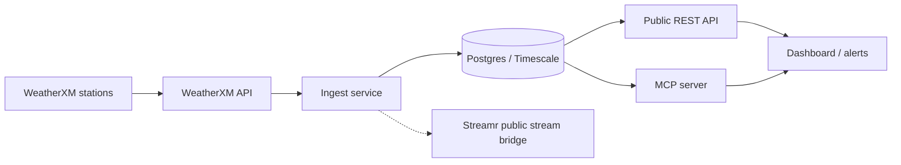

# Atlanta BeltLine Hyper-Local Meteorological Telemetry Network

**Status: proposal / early prototype.**

Serenity Software Solutions LLC proposes a WeatherXM station cluster along the Atlanta BeltLine, plus an open pipeline that turns those stations into a public API, an MCP tool, and (later) a heat, flood, and wind dashboard. No station is deployed. There is no agreement with Atlanta Beltline, Inc., the City of Atlanta, or the BeltLine app.

Phase 1 is a pilot pursuit on consenting private host sites next to the Eastside Trail, not on BeltLine property. The draft application has not been submitted from this repository.

## Problem

The BeltLine is a 22-mile loop used by pedestrians, cyclists, and commuters. Atlanta Beltline reports 2.5 million annual visits (Atlanta Beltline, 2025). Forecasts built from radar and airport stations miss the micro-climates, urban heat islands, and localized storm cells along the loop. Trail users, maintenance crews, and trail-side businesses then react to weather instead of anticipating it.

## Solution

A short-range network of WeatherXM stations, each joined to the WeatherXM network, with an open-source path from those stations to:

- hyper-local precipitation context for low-lying trail segments
- temperature and humidity for urban-heat context in peak summer
- wind readings relevant to vendors, installations, and construction
- a public REST API and an MCP server so people and agents can query what has actually been ingested

Air-quality sensors are a separate, optional layer. They are not WeatherXM-verified data and they are not installed.

About 5 stations are proposed for phase 1. That number is a proposal, not a count of hardware in the field.

## Measured variables

WeatherXM Pro observations, stored with units:

| Variable | Unit |
| --- | --- |
| Temperature, feels-like, dew point | °C |
| Relative humidity | % |
| Precipitation rate | mm/h |
| Precipitation accumulated | mm counter, as reported |
| Wind speed and gust | m/s |
| Wind direction | degrees |
| Barometric pressure | hPa |
| UV index | index |
| Solar irradiance | W/m² |
| Data-quality score | 0–1 |

Heat index, flash-flood watches, and wind advisories are later derivations. This prototype does not compute them.

## Architecture



The solid path is the intended design. In this repository the ingest client, schema, read API, and MCP tool exist and are tested. The dashboard is a placeholder. The Streamr bridge is optional and not enabled: no stream is published.

Stations are addressed by explicit WeatherXM station IDs. The ingest does not treat every station inside a map box as part of the pilot.

99.9% uptime is a design target for solar-capable stations that keep reporting without grid power. It is not a measured figure.

Detail: [docs/architecture.md](docs/architecture.md), [docs/data-model.md](docs/data-model.md).

## Roadmap

Proposed timing from the grant draft, about 24 weeks from approval. Nothing below is funded or scheduled.

| Milestone | Draft window | Outcome |
| --- | --- | --- |
| M1 Eastside Trail pilot cluster | Weeks 0–6 | Site survey, host permission, about 5 WeatherXM stations on private host sites, QoD baseline |
| M2 Open pipeline, API, and MCP | Weeks 6–10 | WeatherXM API to Postgres, QoD filter, public REST API, MCP server, Apache-2.0 repo |
| M3 Dashboard and alerts | Weeks 10–16 | Heat, flood, and wind views; 30-day station-versus-airport comparison |
| M4 Evidence and expansion | Weeks 16–24 | 60–90 day data report, pilot proposal to Atlanta Beltline, Inc., Westside plan |

M2 in this repo is the skeleton only: no public hostname and no live cluster. Full table: [docs/milestones.md](docs/milestones.md).

## Repository layout

```text
ingest/       WeatherXM Pro client and CLI
api/          FastAPI read API
mcp/          stdio MCP server (get_trail_conditions)
dashboard/    placeholder for the M3 UI
db/schema.sql empty Timescale schema
docs/         architecture, milestones, data model
```

## Run the prototype

Python 3.12.

```bash
python3.12 -m venv .venv
source .venv/bin/activate
pip install -e ".[dev]"
pytest
uvicorn api.main:app --reload
```

`GET /health`, `GET /stations`, and `GET /observations/latest` are served at port 8000. Lists are empty until real stations are ingested. Interactive API docs are at `/docs`.

Pull one station after you have a WeatherXM Pro key and a station id. The key stays in the environment.

```bash
export WEATHERXM_API_KEY=...
python -m ingest latest --station-id <uuid>
python -m ingest history --station-id <uuid> --date 2026-10-18
python -m ingest pull --station-id <uuid> --write
```

`--write` stores rows only when `DATABASE_URL` is set. `--segment eastside` is how a confirmed host site is labeled. Leave it off for any other station.

The MCP server speaks newline-delimited JSON-RPC (protocol `2024-11-05`) on stdio:

```bash
python -m mcp.server
```

Postgres and the API together:

```bash
docker compose up --build db api
```

`docker compose --profile ingest run --rm ingest` reads `.env` and writes latest observations. Create `.env` from `.env.example` first. The compose password is a local default.

## API

| Method | Path | Behavior |
| --- | --- | --- |
| GET | `/health` | Process and database reachability. Phase is `proposal`. |
| GET | `/stations` | Stored stations. Optional `segment=eastside` or `westside`. |
| GET | `/observations/latest` | Newest stored reading per station. Same segment filter. |

WeatherXM Pro, which the ingest calls, is documented at <https://pro.weatherxm.com/docs>. The client uses `https://pro.weatherxm.com/api/v1` and the `X-API-KEY` header. Paths: `/stations/{station_id}/latest`, `/stations/{station_id}/history`, and `/stations/{station_id}/health`.

## Data licensing

Software in this repository is Apache-2.0. See [LICENSE](LICENSE).

WeatherXM observations remain under WeatherXM's terms when they are stored or returned here. This project does not relicense them. The `observations.license` column records that.

Air-quality readings, if this project later collects them on its own sensors, are intended for CC BY 4.0 and live in a separate table. None have been collected.

A free public Streamr mirror of corridor data is part of the proposal. It is not configured.

## Contact

Serenity Software Solutions LLC
Rodney Burns, Founder
rodney.burns@s3-bi.tech
<https://s3-bi.tech>

Tennessee team. Proposed deployment region: Atlanta, Georgia.
