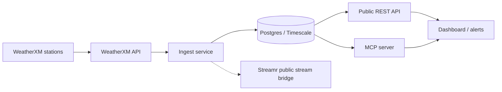

# Architecture

Status: proposal / early prototype. The diagram is the intended system. The repository contains the ingest client, the database schema, a read API, and an MCP tool. Stations, alerts, the dashboard, and the Streamr bridge are not running.

## System

Phase 1 proposes about 5 WeatherXM stations on consenting private host sites next to the Eastside Trail. The stations join the WeatherXM network. This project does not operate a parallel sensor protocol.

The dotted Streamr link is optional and disabled. Nothing is published to Streamr unless `STREAMR_STREAM_ID` is set later, and this prototype has no publisher.

## WeatherXM API

Ingest uses the public WeatherXM Pro API, confirmed against the live OpenAPI document on 2026-10-19.

| Item | Value |
| --- | --- |
| Documentation | https://pro.weatherxm.com/docs |
| OpenAPI | https://pro.weatherxm.com/api/v1/spec |
| Spec version observed | 1.13.4 |
| Base URL | `https://pro.weatherxm.com/api/v1` |
| Authentication | `X-API-KEY` header |

Endpoints the client calls:

- `GET /stations/{station_id}/latest` — latest observation, location, and (deprecated) health block
- `GET /stations/{station_id}/health` — data-quality score when latest omits it
- `GET /stations/{station_id}/history` — `date`, or `start` and `end`, as UTC dates; the documented range limit is 7 days

An unauthenticated request to `/stations/{id}/latest` returns HTTP 401 and `{"message":"API key is missing"}`. The key is read from `WEATHERXM_API_KEY`. It is not stored in the repo.

WeatherXM also publishes a station-owner network API at `https://api.weatherxm.com/api/v1` (OpenAPI 3.42.20 when checked on the same date). That API uses a bearer token and exposes `/api/v1/me/devices/{deviceId}/history` for the signed-in owner. It is a different surface. This prototype does not call it.

Station IDs are an explicit configuration (`WEATHERXM_STATION_IDS` or `--station-id`). The client can see `GET /stations/bounds` and `GET /stations/near` in the Pro spec, and it does not use them. A bounding box around the Eastside Trail would include unrelated stations and would make them look like part of the pilot.

`segment` (`eastside` or `westside`) is applied only when the operator passes it. Untagged rows stay unassigned and are excluded from `get_trail_conditions`.

## Components in this repository

| Piece | Role now |
| --- | --- |
| `ingest/` | CLI and HTTP client. Prints JSON. Writes Postgres only with `--write` and `DATABASE_URL`. |
| `db/schema.sql` | Empty Timescale schema. Observations are a hypertable on `observed_at`. |
| `api/` | FastAPI: `/health`, `/stations`, `/observations/latest`. Reads the store. Does not call WeatherXM. |
| `mcp/` | Stdio MCP server, protocol `2024-11-05`, tool `get_trail_conditions`. |
| `dashboard/` | Placeholder. No UI and no alert delivery. |

With `DATABASE_URL` unset, the API and MCP server use an in-memory store that is empty on each process start. That keeps local review and CI independent of Postgres and of WeatherXM.

## Quality of data

WeatherXM health exposes `data_quality.score` on a 0–1 scale. `QOD_MIN_SCORE=0` keeps every observation, including those with no score. A threshold above 0 drops a lower score and also drops a missing score. Dropped rows are reported by the CLI and are not written.

## Derived products that are not computed

Heat index, a flash-flood watch for low-lying segments, and wind advisories are M3 work. The API note on a non-empty response says the values are station readings, not alerts. The MCP tool uses the same rule.

Air quality is a separate, proposed sensor class. The `air_quality_observations` table exists so those rows cannot land in `observations`. Nothing writes that table yet.

## Availability

99.9% uptime is a design target for the station and backhaul design: low-power, solar-capable WeatherXM hardware, with LPWAN or cellular where a site needs it, including operation without grid power during severe weather. It is not a measured SLA. No uptime figure is collected because no station is deployed.

## What is deliberately absent

- No deployment on the BeltLine, and no host-site list.
- No agreement with Atlanta Beltline, Inc., the City of Atlanta, or the BeltLine app.
- No seeded weather, no sample station map, and no node count beyond the proposed phase 1 cluster of about 5.
- No Streamr stream, no alert sender, and no public hostname for this API.
